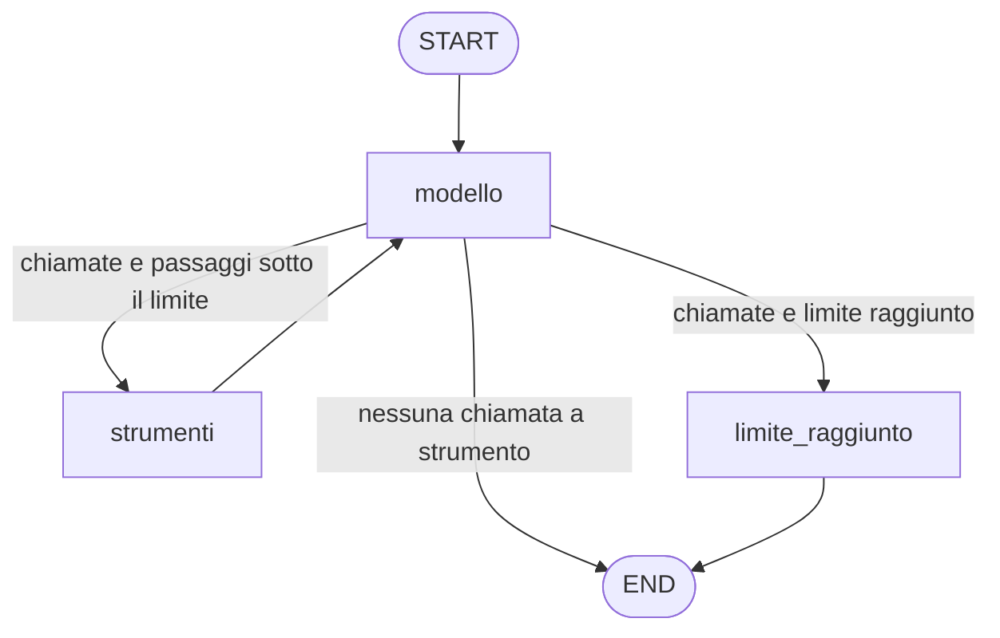

# Assistente del laboratorio

Applicazione da terminale in Python che conversa con un modello locale servito da LM Studio.
Il flusso è un grafo LangGraph esplicito. Il modello chiede gli strumenti con il tool calling e il
programma li esegue davvero. La cronologia dura quanto la sessione.

Gli strumenti sono collegati con tre meccanismi diversi, per confrontarli:

| Strumento | Meccanismo | Dove gira il codice |
|---|---|---|
| `ora_corrente` (fuso orario esplicito) | tool locale | `assistente/strumenti.py` |
| `calcola` (calcolatrice sicura, senza `eval`) | tool locale | `assistente/calcolatrice.py` |
| `converti_unita` (unità come elenco chiuso) | server MCP via stdio | `convertitore_mcp/`, avviato dall'assistente come sottoprocesso |
| `giorni_tra_date`, `calcola_scadenza` | API HTTP | servizio `scadenze_api/`, chiamato con `httpx` da `assistente/client_api.py` |

Per il modello sono tutti normali strumenti: cambia solo dove viene eseguito il codice.

I comandi sono PowerShell (Windows) e vanno lanciati dalla cartella `lezione_4/`.

## Requisiti

- LM Studio con il modello `google/gemma-4-e2b` caricato e il server avviato (porta 1234).
- Python, usato con `py` (verificato con 3.14).
- Docker Desktop, per l'avvio con Compose.

## Configurazione

```powershell
Copy-Item .env.example .env
```

Il file `.env` non va in Git. Le variabili sono:

| Variabile | Obbligatoria | Default |
|---|---|---|
| `LMSTUDIO_BASE_URL` | sì | in locale `http://localhost:1234/v1` |
| `LMSTUDIO_MODEL` | sì | `google/gemma-4-e2b` |
| `FUSO_ORARIO_PREDEFINITO` | no | `Europe/Rome` |
| `MAX_PASSAGGI_STRUMENTI` | no | `3` |
| `LOG_LEVEL` | no | `INFO` (valori: `DEBUG`, `INFO`, `WARNING`, `ERROR`, `CRITICAL`) |
| `SCADENZE_API_URL` | sì | in locale `http://localhost:8000`; in Docker `http://scadenze:8000` (da `docker-compose.yml`) |
| `SCADENZE_API_PORTA` | no | `8000` (porta del servizio `scadenze_api`) |
| `SCADENZE_API_HOST` | no | `127.0.0.1` (solo questo computer); in Docker `0.0.0.0` (da `docker-compose.yml`) |

L'identificativo del modello è quello restituito dal server:

```powershell
Invoke-RestMethod http://localhost:1234/v1/models
```

Nell'elenco `data` serve `google/gemma-4-e2b`. L'altro modello, `text-embedding-nomic-embed-text-v1.5`,
è di embedding e non va usato per la chat.

Ambiente virtuale e dipendenze:

```powershell
py -m venv .venv
.\.venv\Scripts\python -m pip install -r requirements-dev.txt
```

Per caricare `.env` nella sessione PowerShell corrente (serve per l'avvio locale e per la prova reale):

```powershell
Get-Content .env | Where-Object { $_ -match '^\s*[^#\s][^=]*=' } | ForEach-Object { $k, $v = $_ -split '=', 2; Set-Item "env:$($k.Trim())" $v.Trim() }
```

## Avvio

In locale servono due finestre di PowerShell. Nella prima si avvia il servizio di giorni e scadenze
(resta in ascolto finché non si preme Ctrl+C):

```powershell
.\.venv\Scripts\python -m scadenze_api
```

Nella seconda, dopo aver caricato `.env`:

```powershell
.\.venv\Scripts\python -m assistente
```

L'assistente avvia da solo il server MCP del convertitore e lo chiude all'uscita. Il server si può
anche avviare a mano (`.\.venv\Scripts\python -m convertitore_mcp`), ma parla il protocollo MCP su
stdin/stdout ed è pensato per essere lanciato da un client MCP. Se il servizio delle scadenze non è
attivo l'assistente parte lo stesso e i relativi strumenti rispondono con un errore.

Con Docker Compose (legge `.env` con `env_file` e imposta da solo gli indirizzi di LM Studio,
`host.docker.internal`, e del servizio `scadenze`). Il servizio `scadenze` parte da solo come
dipendenza dell'assistente; il server MCP gira dentro il container dell'assistente.
Costruzione delle immagini e sessione con input da pipe, verificate:

```powershell
docker compose build
"Quanto fa 2 + 2?", "Quanti centimetri sono 3 pollici?", "/esci" | docker compose run --rm -T assistente
docker compose down
```

`docker compose down` ferma anche il servizio `scadenze`, che altrimenti resta attivo.

Sessione interattiva con terminale (TTY), verificata a mano con una tastiera reale:

```powershell
docker compose run --rm assistente
```

Si esce con `/esci`, con Ctrl+C (anche durante una risposta) o chiudendo l'input: Ctrl+Z e Invio
in PowerShell in locale, Ctrl+D nel container. Tutti verificati a mano, con un'eccezione: nel
terminale integrato di VS Code Ctrl+Z non chiude l'input (vedi Diagnosi). Le chiamate agli strumenti
compaiono nei log su stderr, per esempio `chiamata strumento ora_corrente con argomenti {...}`.

Sessione locale con input da pipe (verificata):

```powershell
"Che ore sono?", "E a New York?", "/esci" | .\.venv\Scripts\python -m assistente
```

## Test

Suite normale, senza modello attivo (la prova reale risulta saltata):

```powershell
.\.venv\Scripts\python -m pytest -v
```

Suite nel container:

```powershell
docker compose run --rm assistente python -m pytest -v
```

Prova reale con LM Studio, attivata esplicitamente (richiede il server e `.env` caricato):

```powershell
.\.venv\Scripts\python -m pytest --lmstudio -m lmstudio -v -s
```

La prova reale fa una domanda per ogni nuovo strumento (calcolo, conversione, giorni lavorativi)
e una conversione impossibile; avvia da sola il servizio delle scadenze su una porta libera e il server MCP.
Verificata con `google/gemma-4-e2b`: 5 test superati.

Una risposta simulata nei test automatici non dimostra che il modello locale sappia usare lo strumento:
solo la prova reale e le sessioni reali lo fanno.

I test che avviano il server MCP vero (`tests/test_server_mcp.py`, `tests/test_client_mcp.py`) usano
anche un piccolo server di prova, `tests/server_mcp_prova.py`, per simulare un server che cade o
che non risponde in tempo.

## Regole degli strumenti

- **Calcolatrice:** numeri, `+ - * / % **`, parentesi e segno. Tutto il resto (nomi, funzioni,
  testo, confronti) è rifiutato con il motivo. Limiti: 200 caratteri, esponente fino a 100,
  risultati fino a 1e100.
- **Convertitore:** lunghezza (`mm cm m km in ft mi`), massa (`g kg t oz lb`), temperatura
  (`C F K`), volume (`ml l`), tempo (`s min h d`). Grandezze diverse o temperature sotto lo zero
  assoluto danno errore.
- **Giorni e scadenze:** date solo `AAAA-MM-GG`. Il giorno di inizio è escluso, quello di fine
  incluso. I giorni lavorativi escludono sabato, domenica e le festività nazionali del file
  `scadenze_api/dati/festivita_it.json` (anni 2026 e 2027; fonte: legge 260/1949 e successive
  modifiche, legge 151/2025 per il 4 ottobre). Il risultato è indicativo e non ha valore normativo.

## Checklist manuale

Da eseguire in una sessione reale, in locale e in Docker, controllando anche i log. Tutte le voci
sono state verificate con `google/gemma-4-e2b`. Per la voce 4 con una domanda generica su Marte il
modello non chiama lo strumento: per provare l'errore serve una richiesta esplicita, per esempio
"Usa lo strumento ora_corrente con il fuso orario Marte/Base".

1. Domanda sull'ora senza luogo ("Che ore sono?"): una chiamata a `ora_corrente` con il fuso predefinito
   (`Europe/Rome`) e una risposta con l'ora restituita.
2. Domanda con un luogo ("Che ore sono a Tokyo?"): chiamata con `Asia/Tokyo`.
3. Domanda di seguito ("E a New York?"): chiamata con `America/New_York`, perché la domanda si
   capisce solo con la cronologia.
4. Fuso inesistente (per esempio "Che ore sono su Marte/Base?"): lo strumento restituisce
   `Fuso orario non valido` e il modello lo spiega, senza chiudere la sessione.
5. LM Studio spento: la sessione mostra «LM Studio non raggiungibile su ...» e resta aperta.
6. Ctrl+C durante una risposta e subito dopo l'avvio, in locale e in Docker con TTY
   (`docker compose run --rm assistente`): l'assistente si chiude in modo ordinato, senza traceback.
7. Servizio `scadenze_api` spento durante la sessione: una domanda su giorni o scadenze riceve un
   errore spiegato e l'assistente resta aperto.
8. Dopo l'uscita dall'assistente non resta acceso nessun processo `convertitore_mcp`.

## Struttura del grafo



Lo stato ha `messages` (la cronologia) e `passaggi_strumenti` (il contatore, azzerato a ogni domanda).
Il limite è `MAX_PASSAGGI_STRUMENTI`. Il codice è in `assistente/grafo.py`.

## Diagnosi

**«Server MCP del convertitore non avviato»** (l'assistente esce con codice 3): il server
`convertitore_mcp` non è partito o non ha risposto entro 30 secondi. Controllare che le dipendenze
siano installate (`mcp` è in `requirements.txt`) e che l'assistente venga lanciato dalla cartella
`lezione_4/`.

**«Errore: servizio scadenze non raggiungibile su ...»:** in locale il servizio va avviato in
un'altra finestra con `.\.venv\Scripts\python -m scadenze_api` e `SCADENZE_API_URL` deve puntare
alla stessa porta. In Docker l'indirizzo è `http://scadenze:8000`.

**«festività non disponibili per il 2028»:** il file delle festività copre solo il 2026 e il 2027;
per gli altri anni il conteggio dei giorni lavorativi è rifiutato, quello di calendario funziona.

**LM Studio non raggiungibile in locale** ("LM Studio non raggiungibile su ..."):
- il server di LM Studio deve essere avviato;
- `Invoke-RestMethod http://localhost:1234/v1/models` deve rispondere;
- `LMSTUDIO_BASE_URL` deve essere `http://localhost:1234/v1` e `.env` deve essere stato caricato.

**LM Studio non raggiungibile da Docker:**
- nel container l'indirizzo è `http://host.docker.internal:1234/v1`, già impostato da `docker-compose.yml`;
- in LM Studio, nelle impostazioni del server, può servire attivare l'opzione per servire sulla rete
  locale (Serve on Local Network), così il server non ascolta solo su localhost.
  Non è stata necessaria nella prova su questo computer, ma è il primo controllo se la connessione fallisce.

**Il modello non chiama lo strumento:** l'ora risulta inventata e nei log manca la riga
`chiamata strumento`. Controllare che `LMSTUDIO_MODEL` sia il modello di chat previsto
(`google/gemma-4-e2b`), poi riprovare la prova reale mostrando i log in tempo reale:
`.\.venv\Scripts\python -m pytest --lmstudio -m lmstudio -v -s --log-cli-level=INFO`
(`LOG_LEVEL` agisce solo sull'avvio dell'applicazione, non su pytest).
Il comportamento dipende dal modello: solo la prova reale lo conferma.

**Variabile mancante:** l'avvio si ferma con «Variabile d'ambiente obbligatoria mancante o vuota: NOME».
In locale caricare `.env` con la riga PowerShell della sezione Configurazione. In Docker verificare
che `.env` esista. Ogni nuova finestra di PowerShell richiede di caricare di nuovo `.env`.

**Ctrl+Z non chiude la sessione nel terminale di VS Code:** il terminale integrato non trasmette Ctrl+Z
come fine dell'input, e il carattere arriva all'assistente come testo. Nella finestra di PowerShell
normale Ctrl+Z e Invio funzionano. Nel terminale di VS Code usare `/esci` o Ctrl+C.
