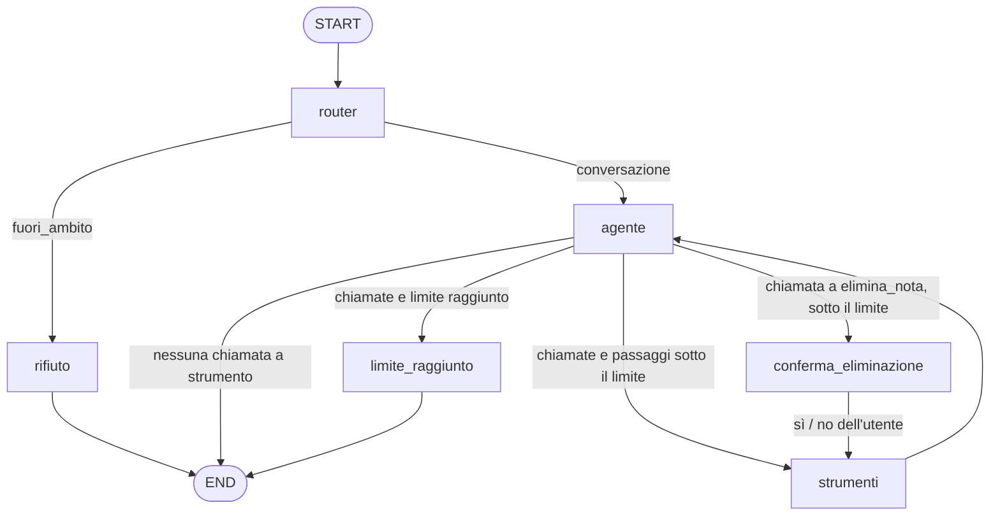

# Assistente del laboratorio

Applicazione da terminale in Python che conversa con un modello locale servito da LM Studio.
Il flusso è un grafo LangGraph esplicito. Il modello chiede gli strumenti con il tool calling e il
programma li esegue davvero. La cronologia dura quanto la sessione; le note personali invece
restano salvate in un file SQLite.

Gli strumenti sono collegati con tre meccanismi diversi, per confrontarli:

| Strumento | Meccanismo | Dove gira il codice |
|---|---|---|
| `ora_corrente` (fuso orario esplicito) | tool locale | `assistente/strumenti.py` |
| `calcola` (calcolatrice sicura, senza `eval`) | tool locale | `assistente/calcolatrice.py` |
| `cerca_articoli`, `dettaglio_articolo` (catalogo del laboratorio) | tool locale | `assistente/catalogo.py`, dati in `assistente/dati/catalogo.json` |
| `aggiungi_nota`, `elenca_note`, `cerca_note`, `elimina_nota` (note personali, eliminazione con conferma) | tool locale | `assistente/note.py`, dati in un file SQLite |
| `converti_unita` (unità come elenco chiuso) | server MCP via stdio | `convertitore_mcp/`, avviato dall'assistente come sottoprocesso |
| `giorni_tra_date`, `calcola_scadenza` | API HTTP | servizio `scadenze_api/`, chiamato con `httpx` da `assistente/client_api.py` |

Per il modello sono tutti normali strumenti: cambia solo dove viene eseguito il codice.

Prima dell'agente un router classifica ogni domanda come `conversazione` o `fuori_ambito`
rispetto all'ambito scritto in `AMBITO_AGENTE`: le domande fuori ambito ricevono un rifiuto
senza che l'agente venga eseguito.

I comandi sono PowerShell (Windows) e vanno lanciati dalla cartella `lezione_4/`.

## Requisiti

- LM Studio con il modello `google/gemma-4-e2b` caricato e il server avviato (porta 1234).
- Python, usato con `py` (verificato con 3.14).
- Docker Desktop, per l'avvio con Compose.

## Configurazione

```powershell
Copy-Item .env.example .env
```

Il file `.env` non va in Git. Le variabili sono:

| Variabile | Obbligatoria | Default |
|---|---|---|
| `LMSTUDIO_BASE_URL` | sì | in locale `http://localhost:1234/v1` |
| `LMSTUDIO_MODEL` | sì | `google/gemma-4-e2b` |
| `FUSO_ORARIO_PREDEFINITO` | no | `Europe/Rome` |
| `MAX_PASSAGGI_STRUMENTI` | no | `3` |
| `LOG_LEVEL` | no | `INFO` (valori: `DEBUG`, `INFO`, `WARNING`, `ERROR`, `CRITICAL`) |
| `SCADENZE_API_URL` | sì | in locale `http://localhost:8000`; in Docker `http://scadenze:8000` (da `docker-compose.yml`) |
| `SCADENZE_API_PORTA` | no | `8000` (porta del servizio `scadenze_api`) |
| `SCADENZE_API_HOST` | no | `127.0.0.1` (solo questo computer); in Docker `0.0.0.0` (da `docker-compose.yml`) |
| `PERCORSO_DB_NOTE` | no | `note.sqlite3`; in Docker `/app/note/note.sqlite3`, sul volume `note` (da `docker-compose.yml`) |
| `AMBITO_AGENTE` | sì | il testo di `.env.example` (strumenti del laboratorio, temi del corso, saluti) |

`AMBITO_AGENTE` descrive in una riga, senza virgolette, di che cosa si occupa l'assistente. Il router
la usa per decidere se una domanda è in ambito e il messaggio di rifiuto la riporta all'utente.
Per accettare nuovi argomenti si cambia questa variabile, non il codice. Se manca, l'avvio si ferma
con codice di uscita 2.

L'identificativo del modello è quello restituito dal server:

```powershell
Invoke-RestMethod http://localhost:1234/v1/models
```

Nell'elenco `data` serve `google/gemma-4-e2b`. L'altro modello, `text-embedding-nomic-embed-text-v1.5`,
è di embedding e non va usato per la chat.

Ambiente virtuale e dipendenze:

```powershell
py -m venv .venv
.\.venv\Scripts\python -m pip install -r requirements-dev.txt
```

Per caricare `.env` nella sessione PowerShell corrente (serve per l'avvio locale e per la prova reale):

```powershell
Get-Content .env | Where-Object { $_ -match '^\s*[^#\s][^=]*=' } | ForEach-Object { $k, $v = $_ -split '=', 2; Set-Item "env:$($k.Trim())" $v.Trim() }
```

## Avvio

In locale servono due finestre di PowerShell. Nella prima si avvia il servizio di giorni e scadenze
(resta in ascolto finché non si preme Ctrl+C):

```powershell
.\.venv\Scripts\python -m scadenze_api
```

Nella seconda, dopo aver caricato `.env`:

```powershell
.\.venv\Scripts\python -m assistente
```

L'assistente avvia da solo il server MCP del convertitore e lo chiude all'uscita. Il server si può
anche avviare a mano (`.\.venv\Scripts\python -m convertitore_mcp`), ma parla il protocollo MCP su
stdin/stdout ed è pensato per essere lanciato da un client MCP. Se il servizio delle scadenze non è
attivo l'assistente parte lo stesso e i relativi strumenti rispondono con un errore.

Con Docker Compose (legge `.env` con `env_file` e imposta da solo gli indirizzi di LM Studio,
`host.docker.internal`, e del servizio `scadenze`). Il servizio `scadenze` parte da solo come
dipendenza dell'assistente; il server MCP gira dentro il container dell'assistente.
Costruzione delle immagini e sessione con input da pipe, verificate:

```powershell
docker compose build
"Quanto fa 2 + 2?", "Quanti centimetri sono 3 pollici?", "/esci" | docker compose run --rm -T assistente
docker compose down
```

`docker compose down` ferma anche il servizio `scadenze`, che altrimenti resta attivo.

Le note personali (vedi «Note personali») stanno nel volume Docker `note`, montato su `/app/note`
(`PERCORSO_DB_NOTE=/app/note/note.sqlite3`, impostato da `docker-compose.yml`). Restano anche
quando il container viene ricreato e dopo `docker compose down`; **`docker compose down -v` cancella
il volume e con lui tutte le note**. Prova verificata con due sessioni separate:

```powershell
"Annota che il saldatore va pulito", "/esci" | docker compose run --rm -T assistente
"Quali note ho?", "/esci" | docker compose run --rm -T assistente
```

Sessione interattiva con terminale (TTY), verificata a mano con una tastiera reale:

```powershell
docker compose run --rm assistente
```

Si esce con `/esci`, con Ctrl+C (anche durante una risposta) o chiudendo l'input: Ctrl+Z e Invio
in PowerShell in locale, Ctrl+D nel container. Tutti verificati a mano, con un'eccezione: nel
terminale integrato di VS Code Ctrl+Z non chiude l'input (vedi Diagnosi). Le chiamate agli strumenti
compaiono nei log su stderr, per esempio `chiamata strumento ora_corrente con argomenti {...}`.

Dopo ogni domanda compare `(attendi: il modello sta rispondendo...)`: la risposta può richiedere
decine di secondi, ed è meglio aspettare il prompt successivo (`Tu>` o `Conferma>`) prima di
scrivere. Gli orari nei log del container sono in UTC; le date delle note usano
`FUSO_ORARIO_PREDEFINITO`.

Sessione locale con input da pipe (verificata):

```powershell
"Che ore sono?", "E a New York?", "/esci" | .\.venv\Scripts\python -m assistente
```

## Test

Suite normale, senza modello attivo (la prova reale risulta saltata):

```powershell
.\.venv\Scripts\python -m pytest -v
```

Suite nel container:

```powershell
docker compose run --rm assistente python -m pytest -v
```

Prova reale con LM Studio, attivata esplicitamente (richiede il server e `.env` caricato):

```powershell
.\.venv\Scripts\python -m pytest --lmstudio -m lmstudio -v -s
```

Solo le prove reali del router (domanda in ambito con strumento, fuori ambito, tema del corso,
domanda di seguito), 4 test, circa 6 minuti:

```powershell
.\.venv\Scripts\python -m pytest --lmstudio -m lmstudio -k router -v -s
```

Verificate con `google/gemma-4-e2b`: 4 superati su 4.

La prova reale completa fa anche una domanda per ogni strumento (ora, calcolo, conversione, giorni lavorativi),
una conversione impossibile, cinque domande sul catalogo (ricerca, dettaglio, ricerca seguita da
dettaglio, nessun risultato, codice inesistente) e sei sulle note (aggiunta, ricerca, elenco,
nessun risultato, eliminazione confermata, eliminazione annullata), in tutto 16 test; avvia da sola
il servizio delle scadenze su una porta libera e il server MCP, e usa un archivio delle note
temporaneo. Le prove controllano quali strumenti vengono chiamati e con quali argomenti; le risposte
finali sono stampate (`-s`) e vanno lette a occhio per verificare che il modello non inventi
articoli o note. Richiede 23–29 minuti.

Verificata con `google/gemma-4-e2b`: 15 test superati su 16. Le sei prove delle note passano;
`test_catalogo_ricerca_poi_dettaglio` non è stabile (ripetuta tre volte passa due): quando fallisce il
modello cerca con `categoria=sensori` e poi non chiama `dettaglio_articolo`. Anche con temperatura 0
il modello non risponde sempre allo stesso modo.

Una risposta simulata nei test automatici non dimostra che il modello locale sappia usare lo strumento:
solo la prova reale e le sessioni reali lo fanno.

I test che avviano il server MCP vero (`tests/test_server_mcp.py`, `tests/test_client_mcp.py`) usano
anche un piccolo server di prova, `tests/server_mcp_prova.py`, per simulare un server che cade o
che non risponde in tempo.

## Regole degli strumenti

- **Calcolatrice:** numeri, `+ - * / % **`, parentesi e segno. Tutto il resto (nomi, funzioni,
  testo, confronti) è rifiutato con il motivo. Limiti: 200 caratteri, esponente fino a 100,
  risultati fino a 1e100.
- **Convertitore:** lunghezza (`mm cm m km in ft mi`), massa (`g kg t oz lb`), temperatura
  (`C F K`), volume (`ml l`), tempo (`s min h d`). Grandezze diverse o temperature sotto lo zero
  assoluto danno errore.
- **Giorni e scadenze:** date solo `AAAA-MM-GG`. Il giorno di inizio è escluso, quello di fine
  incluso. I giorni lavorativi escludono sabato, domenica e le festività nazionali del file
  `scadenze_api/dati/festivita_it.json` (anni 2026 e 2027; fonte: legge 260/1949 e successive
  modifiche, legge 151/2025 per il 4 ottobre). Il risultato è indicativo e non ha valore normativo.
- **Catalogo:** sola lettura, dal file `assistente/dati/catalogo.json` (vedi sotto).
- **Note:** testo fino a 500 caratteri; elenco e ricerca mostrano al massimo le 20 note più
  recenti. L'eliminazione avviene solo dopo un «sì» dell'utente (vedi sotto).

## Note personali

Le note sono promemoria dell'utente salvati in un file SQLite che resta dopo la chiusura
dell'assistente; la cronologia della conversazione invece sparisce, come prima. Il file è
`PERCORSO_DB_NOTE` (predefinito `note.sqlite3` nella cartella da cui si avvia l'assistente; la
cartella viene creata se manca). I file `*.sqlite3` sono esclusi da Git e dall'immagine Docker; in
Docker il file sta sul volume `note` (vedi «Avvio»).

Ogni nota ha un numero, che non viene mai riusato dopo un'eliminazione, la data di creazione (nel
fuso `FUSO_ORARIO_PREDEFINITO`) e il testo.

- `aggiungi_nota(testo)`: salva subito, senza conferma.
- `elenca_note()`: tutte le note, in ordine di numero.
- `cerca_note(testo)`: le note che contengono tutte le parole; maiuscole e accenti non contano.
  Se non trova nulla lo dice esplicitamente.
- `elimina_nota(numero)`: prima di eseguirla il grafo si ferma e il terminale mostra la nota presa
  dall'archivio, non dal modello:

  ```text
  Eliminare la nota 3 (2026-11-02 14:05): "il sensore SEN-004 va ricalibrato"? [sì/no]
  Conferma>
  ```

  `sì`, `si` o `s` (maiuscole e spazi non contano) eliminano; qualunque altra risposta, anche una
  riga vuota, lascia la nota com'è. Ctrl+C o la fine dell'input durante la conferma chiudono
  l'assistente senza eliminare. Si elimina una nota alla volta.

  Nel terminale interattivo, prima di `Conferma>` l'assistente scarta quanto è stato scritto mentre
  il modello lavorava: la conferma vale solo per la risposta data dopo aver letto la domanda. Con
  l'input da pipe nulla viene scartato.

Esempi di richieste: «Annota che il saldatore va pulito», «Cosa avevo scritto sul sensore?»,
«Quali note ho?», «Elimina la nota sul sensore».

## Catalogo del laboratorio

Il file `assistente/dati/catalogo.json` è una lista di articoli con i campi `codice`, `nome`,
`categoria`, `descrizione`, `quantita` (intero ≥ 0) e `posizione`. Categorie e prefissi del codice
(formato `AAA-000`):

| Prefisso | Categoria |
|---|---|
| `SCH` | schede |
| `SEN` | sensori |
| `ATT` | attuatori |
| `CAV` | cavi |
| `ALI` | alimentazione |
| `MIS` | strumenti di misura |

Il file viene letto e controllato all'avvio: campi mancanti o in più, testi vuoti, codice fuori
formato o con prefisso diverso dalla categoria, categoria sconosciuta, quantità non intera o
negativa e codici duplicati fermano l'assistente con «Catalogo non valido: ...» (codice di uscita 4).

- `cerca_articoli(testo, categoria)`: tutte le parole del testo devono comparire in nome,
  descrizione o categoria; maiuscole e accenti non contano, singolari e plurali sì. Al massimo
  10 risultati. Se non trova nulla lo dice esplicitamente.
- `dettaglio_articolo(codice)`: scheda completa; spazi, trattini e maiuscole nel codice non contano.

Esempi di domande: «Avete sensori di temperatura?», «Dimmi tutto su SEN-004», «Dov'è il sensore di
umidità?», «Avete stampanti 3D?» (nessun risultato), «Dammi il dettaglio dell'articolo XYZ-999»
(codice inesistente).

## Checklist manuale

Da eseguire in una sessione reale, in locale e in Docker, controllando anche i log. Le voci 1–9
sono state verificate con `google/gemma-4-e2b`; la 10 in parte (vedi la voce). Per la voce 4 con una domanda generica su Marte il
modello non chiama lo strumento: per provare l'errore serve una richiesta esplicita, per esempio
"Usa lo strumento ora_corrente con il fuso orario Marte/Base".

1. Domanda sull'ora senza luogo ("Che ore sono?"): una chiamata a `ora_corrente` con il fuso predefinito
   (`Europe/Rome`) e una risposta con l'ora restituita.
2. Domanda con un luogo ("Che ore sono a Tokyo?"): chiamata con `Asia/Tokyo`.
3. Domanda di seguito ("E a New York?"): chiamata con `America/New_York`, perché la domanda si
   capisce solo con la cronologia.
4. Fuso inesistente (per esempio "Che ore sono su Marte/Base?"): lo strumento restituisce
   `Fuso orario non valido` e il modello lo spiega, senza chiudere la sessione.
5. LM Studio spento: la sessione mostra «LM Studio non raggiungibile su ...» e resta aperta.
6. Ctrl+C durante una risposta e subito dopo l'avvio, in locale e in Docker con TTY
   (`docker compose run --rm assistente`): l'assistente si chiude in modo ordinato, senza traceback.
7. Servizio `scadenze_api` spento durante la sessione: una domanda su giorni o scadenze riceve un
   errore spiegato e l'assistente resta aperto.
8. Dopo l'uscita dall'assistente non resta acceso nessun processo `convertitore_mcp`.
9. Catalogo: le cinque domande di esempio della sezione «Catalogo del laboratorio». Nei log
   compaiono `cerca_articoli` e/o `dettaglio_articolo`; le risposte citano solo articoli, quantità
   e posizioni presenti nel file. Verificata con la prova reale e, in Docker, con
   `"Avete sensori di temperatura?", "/esci" | docker compose run --rm -T assistente`.
10. Note: «Annota che il saldatore va pulito» chiama `aggiungi_nota`; in una sessione nuova «Quali
    note ho?» la ritrova (in Docker grazie al volume `note`). «Elimina la nota sul saldatore» mostra
    la riga `Conferma>`: con `no` la nota resta, con `sì` viene eliminata; Ctrl+C durante
    `Conferma>` chiude l'assistente senza eliminare. Verificata con la prova reale e in Docker con
    input da pipe (aggiunta, ritrovata in una seconda sessione, eliminazione con conferma);
    **da verificare a mano** la sessione interattiva con la conferma, in locale e in Docker con TTY,
    compreso Ctrl+C durante `Conferma>`.
11. Router, con `LOG_LEVEL=INFO`: «Che ore sono a Tokyo?» produce nei log `router: categoria=conversazione
    ... -> agente`, poi `agente: chiamata al modello` e la chiamata a `ora_corrente`; «Dammi la ricetta
    della carbonara» produce `router: categoria=fuori_ambito ... -> rifiuto` e `rifiuto: domanda fuori
    ambito, agente non eseguito`, senza nessuna riga `agente:`, e la risposta elenca l'ambito.
    Verificata in locale con
    `"Che ore sono a Tokyo?", "Dammi la ricetta della carbonara", "/esci" | .\.venv\Scripts\python -m assistente`
    (servizio `scadenze_api` avviato in un'altra finestra); da verificare in Docker.

## Struttura del grafo



Lo stato ha `messages` (la cronologia), `passaggi_strumenti` (il contatore, azzerato a ogni domanda),
`eliminazioni_confermate` (le chiamate a `elimina_nota` confermate dall'utente), `categoria` e
`motivo` (la decisione del router per la domanda corrente). Il limite è `MAX_PASSAGGI_STRUMENTI`.
Il codice è in `assistente/grafo.py`; prompt, schema della decisione e messaggio di rifiuto sono in
`assistente/router.py`.

`router` chiama lo stesso modello con output strutturato (`json_schema`): riceve l'ambito, gli ultimi
turni della conversazione (solo domande e risposte finali, senza chiamate agli strumenti) e la domanda
corrente, e restituisce `categoria` e `motivo`. Non sceglie gli strumenti: quello resta compito di
`agente`. Se l'output non è valido (vuoto, JSON troncato, categoria fuori schema, risposta interrotta
per lunghezza) la domanda passa comunque all'agente (fail-open), con un `WARNING` nei log; questi casi
sono intercettati in `crea_router` (`assistente/modello.py`). LM Studio irraggiungibile o un errore del
server invece non sono fail-open: il turno fallisce con il messaggio di errore e la cronologia resta
intatta. `rifiuto` risponde con un testo fisso che riporta l'ambito, senza chiamare il modello.

`conferma_eliminazione` legge la nota dall'archivio e, se esiste, ferma il grafo con `interrupt()`;
il terminale fa la domanda e riprende il grafo con `Command(resume=True/False)`. `strumenti` esegue
`elimina_nota` solo se la chiamata è confermata. Per fermarsi e riprendere il grafo usa un
checkpointer in memoria (`InMemorySaver`) e un thread nuovo per ogni domanda: la cronologia resta
quella della sessione e si aggiorna solo quando il turno finisce bene.

## Diagnosi

**«Server MCP del convertitore non avviato»** (l'assistente esce con codice 3): il server
`convertitore_mcp` non è partito o non ha risposto entro 30 secondi. Controllare che le dipendenze
siano installate (`mcp` è in `requirements.txt`) e che l'assistente venga lanciato dalla cartella
`lezione_4/`.

**«Archivio note non disponibile: ...»** (l'assistente esce con codice 5): il file indicato da
`PERCORSO_DB_NOTE` non si può creare o aprire (cartella non creabile, file non scrivibile, file che
non è un database SQLite). Correggere il percorso o spostare il file non valido.

**«Catalogo non valido: ...»** (l'assistente esce con codice 4): il messaggio indica l'articolo
(posizione nella lista e codice) e il motivo; correggere `assistente/dati/catalogo.json`.

**«Errore: servizio scadenze non raggiungibile su ...»:** in locale il servizio va avviato in
un'altra finestra con `.\.venv\Scripts\python -m scadenze_api` e `SCADENZE_API_URL` deve puntare
alla stessa porta. In Docker l'indirizzo è `http://scadenze:8000`.

**«festività non disponibili per il 2028»:** il file delle festività copre solo il 2026 e il 2027;
per gli altri anni il conteggio dei giorni lavorativi è rifiutato, quello di calendario funziona.

**LM Studio non raggiungibile in locale** ("LM Studio non raggiungibile su ..."):
- il server di LM Studio deve essere avviato;
- `Invoke-RestMethod http://localhost:1234/v1/models` deve rispondere;
- `LMSTUDIO_BASE_URL` deve essere `http://localhost:1234/v1` e `.env` deve essere stato caricato.

**LM Studio non raggiungibile da Docker:**
- nel container l'indirizzo è `http://host.docker.internal:1234/v1`, già impostato da `docker-compose.yml`;
- in LM Studio, nelle impostazioni del server, può servire attivare l'opzione per servire sulla rete
  locale (Serve on Local Network), così il server non ascolta solo su localhost.
  Non è stata necessaria nella prova su questo computer, ma è il primo controllo se la connessione fallisce.

**Il modello non chiama lo strumento:** l'ora risulta inventata e nei log manca la riga
`chiamata strumento`. Controllare che `LMSTUDIO_MODEL` sia il modello di chat previsto
(`google/gemma-4-e2b`), poi riprovare la prova reale mostrando i log in tempo reale:
`.\.venv\Scripts\python -m pytest --lmstudio -m lmstudio -v -s --log-cli-level=INFO`
(`LOG_LEVEL` agisce solo sull'avvio dell'applicazione, non su pytest).
Il comportamento dipende dal modello: solo la prova reale lo conferma.

**Righe del router nei log** (con `LOG_LEVEL=INFO`):
- `router: categoria=<categoria> motivo=<motivo> -> <agente|rifiuto>`: la decisione per la domanda;
- `agente: chiamata al modello`: l'agente è stato eseguito (manca per le domande rifiutate);
- `rifiuto: domanda fuori ambito, agente non eseguito`;
- `WARNING ... router: output non valido (...), la domanda passa all'agente`: il modello non ha
  restituito una decisione valida e la domanda è trattata come in ambito.

**Una domanda valida viene rifiutata:** leggere il `motivo` nella riga `router:` e allargare
`AMBITO_AGENTE` nel `.env` con l'argomento mancante, poi ricaricare `.env` e riavviare l'assistente.
Il router dipende dal modello: una riformulazione della domanda può dare un esito diverso.

**Variabile mancante:** l'avvio si ferma con «Variabile d'ambiente obbligatoria mancante o vuota: NOME».
In locale caricare `.env` con la riga PowerShell della sezione Configurazione. In Docker verificare
che `.env` esista. Ogni nuova finestra di PowerShell richiede di caricare di nuovo `.env`.

**Ctrl+Z non chiude la sessione nel terminale di VS Code:** il terminale integrato non trasmette Ctrl+Z
come fine dell'input, e il carattere arriva all'assistente come testo. Nella finestra di PowerShell
normale Ctrl+Z e Invio funzionano. Nel terminale di VS Code usare `/esci` o Ctrl+C.
