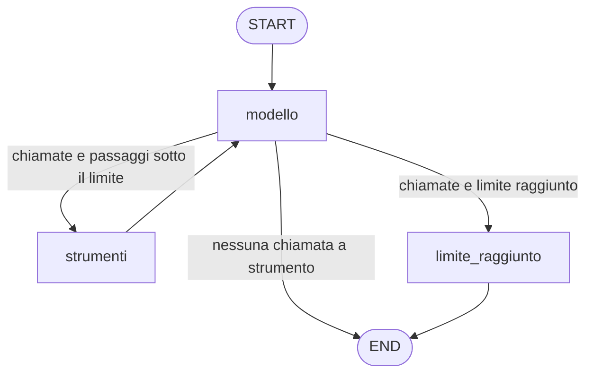

# Assistente del laboratorio

Applicazione da terminale in Python che conversa con un modello locale servito da LM Studio.
Il flusso è un grafo LangGraph esplicito. Il modello può chiedere lo strumento `ora_corrente`
(fuso orario esplicito) con il tool calling e il programma lo esegue davvero.
La cronologia dura quanto la sessione.

I comandi sono PowerShell (Windows) e vanno lanciati dalla cartella `lezione_4/`.

## Requisiti

- LM Studio con il modello `google/gemma-4-e2b` caricato e il server avviato (porta 1234).
- Python, usato con `py` (verificato con 3.14).
- Docker Desktop, per l'avvio con Compose.

## Configurazione

```powershell
Copy-Item .env.example .env
```

Il file `.env` non va in Git. Le variabili sono:

| Variabile | Obbligatoria | Default |
|---|---|---|
| `LMSTUDIO_BASE_URL` | sì | in locale `http://localhost:1234/v1` |
| `LMSTUDIO_MODEL` | sì | `google/gemma-4-e2b` |
| `FUSO_ORARIO_PREDEFINITO` | no | `Europe/Rome` |
| `MAX_PASSAGGI_STRUMENTI` | no | `3` |
| `LOG_LEVEL` | no | `INFO` |

L'identificativo del modello è quello restituito dal server:

```powershell
Invoke-RestMethod http://localhost:1234/v1/models
```

Nell'elenco `data` serve `google/gemma-4-e2b`. L'altro modello, `text-embedding-nomic-embed-text-v1.5`,
è di embedding e non va usato per la chat.

Ambiente virtuale e dipendenze:

```powershell
py -m venv .venv
.\.venv\Scripts\python -m pip install -r requirements-dev.txt
```

Per caricare `.env` nella sessione PowerShell corrente (serve per l'avvio locale e per la prova reale):

```powershell
Get-Content .env | Where-Object { $_ -match '^\s*[^#\s][^=]*=' } | ForEach-Object { $k, $v = $_ -split '=', 2; Set-Item "env:$($k.Trim())" $v.Trim() }
```

## Avvio

In locale, dopo aver caricato `.env`:

```powershell
.\.venv\Scripts\python -m assistente
```

Con Docker Compose (legge `.env` con `env_file` e imposta da solo l'indirizzo
`host.docker.internal`). Costruzione dell'immagine e sessione con input da pipe, entrambe verificate:

```powershell
docker compose build
"Che ore sono?", "/esci" | docker compose run --rm -T assistente
```

Sessione interattiva con terminale (TTY), **da verificare a mano dall'utente**: non è stata eseguita
con una tastiera reale.

```powershell
docker compose run --rm assistente
```

In locale si esce con `/esci`. Le chiamate agli strumenti compaiono nei log su stderr, per esempio
`chiamata strumento ora_corrente con argomenti {...}`. Ctrl+C e Ctrl+D (Ctrl+Z e Invio su Windows)
sono previsti dalla specifica ma **da verificare a mano dall'utente**.

Sessione locale con input da pipe (verificata):

```powershell
"Che ore sono?", "E a New York?", "/esci" | .\.venv\Scripts\python -m assistente
```

## Test

Suite normale, senza modello attivo (la prova reale risulta saltata):

```powershell
.\.venv\Scripts\python -m pytest -v
```

Suite nel container:

```powershell
docker compose run --rm assistente python -m pytest -v
```

Prova reale con LM Studio, attivata esplicitamente (richiede il server e `.env` caricato):

```powershell
.\.venv\Scripts\python -m pytest --lmstudio -m lmstudio -v -s
```

Una risposta simulata nei test automatici non dimostra che il modello locale sappia usare lo strumento:
solo la prova reale e le sessioni reali lo fanno.

## Checklist manuale

Da eseguire in una sessione reale, in locale e in Docker, controllando anche i log:

1. Domanda sull'ora senza luogo ("Che ore sono?"): una chiamata a `ora_corrente` con il fuso predefinito
   (`Europe/Rome`) e una risposta con l'ora restituita.
2. Domanda con un luogo ("Che ore sono a Tokyo?"): chiamata con `Asia/Tokyo`.
3. Domanda di seguito ("E a New York?"): chiamata con `America/New_York`, perché la domanda si
   capisce solo con la cronologia.
4. Fuso inesistente (per esempio "Che ore sono su Marte/Base?"): lo strumento restituisce
   `Fuso orario non valido` e il modello lo spiega, senza chiudere la sessione.
5. LM Studio spento: la sessione mostra «LM Studio non raggiungibile su ...» e resta aperta.

## Struttura del grafo



Lo stato ha `messages` (la cronologia) e `passaggi_strumenti` (il contatore, azzerato a ogni domanda).
Il limite è `MAX_PASSAGGI_STRUMENTI`. Il codice è in `assistente/grafo.py`.

## Diagnosi

**LM Studio non raggiungibile in locale** ("LM Studio non raggiungibile su ..."):
- il server di LM Studio deve essere avviato;
- `Invoke-RestMethod http://localhost:1234/v1/models` deve rispondere;
- `LMSTUDIO_BASE_URL` deve essere `http://localhost:1234/v1` e `.env` deve essere stato caricato.

**LM Studio non raggiungibile da Docker:**
- nel container l'indirizzo è `http://host.docker.internal:1234/v1`, già impostato da `docker-compose.yml`;
- in LM Studio, nelle impostazioni del server, può servire attivare l'opzione per servire sulla rete
  locale (Serve on Local Network), così il server non ascolta solo su localhost.
  Non è stata necessaria nella prova su questo computer, ma è il primo controllo se la connessione fallisce.

**Il modello non chiama lo strumento:** l'ora risulta inventata e nei log manca la riga
`chiamata strumento`. Controllare che `LMSTUDIO_MODEL` sia il modello di chat previsto
(`google/gemma-4-e2b`), poi riprovare la prova reale mostrando i log in tempo reale:
`.\.venv\Scripts\python -m pytest --lmstudio -m lmstudio -v -s --log-cli-level=INFO`
(`LOG_LEVEL` agisce solo sull'avvio dell'applicazione, non su pytest).
Il comportamento dipende dal modello: solo la prova reale lo conferma.

**Variabile mancante:** l'avvio si ferma con «Variabile d'ambiente obbligatoria mancante o vuota: NOME».
In locale caricare `.env` con la riga PowerShell della sezione Configurazione. In Docker verificare
che `.env` esista.
